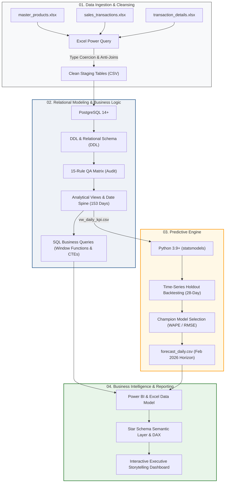

<div align="center">

# 📊 Enterprise Retail Sales & Demand Analytics Report

### Toko Fotocopy & Percetakan Raffa Rafli (RR Analytics)

**Comprehensive End-to-End Business Intelligence, Data Engineering & Time-Series Forecasting**

[](https://www.postgresql.org/)
[](https://www.python.org/)
[](https://powerbi.microsoft.com/)
[](https://www.microsoft.com/excel)
[](https://www.statsmodels.org/)
[-brightgreen?style=for-the-badge>)](sql/03_quality_checks.sql)

```
[ Domain: Retail & Printing Services ] • [ Period: 1 Sep 2025 - 31 Jan 2026 (153 Days) ] • [ Grain: 1,423 Orders / 1,739 Lines ]
```

---


</div>

---

> [!NOTE]  
> **Konsep Dokumen:** Laporan ini menggabungkan **Laporan Keputusan Bisnis Eksekutif** untuk Owner Toko Fotocopy Raffa Rafli dengan **Dokumentasi Teknis Standar Industri** (_Data Engineering, Relational Modeling, Business Intelligence, dan Predictive Analytics_).

---

## 🛠️ 1. Tech Stack & Analytics Architecture

Arsitektur analitis dirancang secara modular dan _decoupled_, di mana masing-masing teknologi memegang tanggung jawab spesifik tanpa pencampuran fungsi (_single-responsibility principle_):



### Matriks Tanggung Jawab Teknologi

| Layer Arsitektur              | Teknologi              | Fungsi & Tanggung Jawab Utama                                                                                         | Artefak Output                              |
| ----------------------------- | ---------------------- | --------------------------------------------------------------------------------------------------------------------- | ------------------------------------------- |
| **Data Cleaning & QA**        | `Excel Power Query`    | Skema intake, standardisasi data type, audit orphan records, deteksi inkonsistensi harga master vs detail line.       | `clean_*.csv`, `Fotocopy RR Analytics.xlsx` |
| **Relational Data Warehouse** | `PostgreSQL 14+`       | _Source of truth_ logika bisnis, relasi star-schema, complete date spine (zero-sales preservation), window functions. | `01`–`06_*.sql`, `analytics.vw_*`           |
| **Predictive Analytics**      | `Python (statsmodels)` | Holdout backtesting 6 algoritma time-series, penanganan data intermiten dengan WAPE, estimasi interval keyakinan 95%. | `forecast.py`, `forecast_daily.csv`         |
| **Semantic BI & Delivery**    | `Power BI & Excel`     | Semantic model star-schema, kalkulasi dinamis ukuran DAX, dashboard interaktif dengan navigasi cross-filtering.       | `Dashboard Excel.png`, Visual Pages         |

---

## 📌 2. Ringkasan Eksekutif (Executive Summary)

Kepada Yth. **Owner Fotocopy Raffa Rafli**,

Berdasarkan audit komprehensif terhadap 1.423 transaksi senilai **Rp 12.962.000,00** selama 5 bulan operasional (1 September 2025 s.d. 31 Januari 2026), berikut adalah intisari performa bisnis toko Anda:

1. **Efisiensi Margin yang Solid:** Toko menghasilkan laba kotor (_gross profit_) sebesar **Rp 5.865.200,00** dengan margin keseluruhan yang sehat di angka **45,25%**.
2. **Ketergantungan Kuat pada Jasa (_The Profit Engine_):** Kategori Layanan Jasa (Fotocopy, Print, Scan, Jilid) adalah sumber hidup utama bisnis. Jasa menyumbang **69,56% dari total laba kotor** dengan profit margin **59,89%**, sedangkan Produk ATK fisik hanya membukukan margin **29,03%**.
3. **Peringatan Volatilitas Kalender Akademik:** Pola penjualan sangat reaktif terhadap kalender sekolah. Omzet menyusut ke titik terendah pada **Desember 2025 (Rp 2,09 jt)** akibat libur semester, lalu melonjak drastis pada **Januari 2026 (Rp 3,70 jt / +76,57% MoM)** saat tahun ajaran baru dimulai.
4. **Hambatan Jam Operasional (_Bottleneck_):** Penjualan terkonsentrasi sangat padat pada dua jendela: **07:00 – 09:00 WIB** (pagi) dan **16:00 – 17:00 WIB** (sore), yang menguras kapasitas mesin cetak dan menyebabkan antrean panjang.

---

## 📈 3. Kartu Metrik Utama (Key Performance Indicators)

> [!IMPORTANT]
> **Audit Rekonsiliasi Finansial (Zero Discrepancy):**  
> `SUM(Transactions.final_amount) [Rp 12.962.000,00]` **==** `SUM(Transaction_Details.subtotal) [Rp 12.962.000,00]`.  
> Tidak ditemukan duplikasi order maupun ketidakcocokan nilai aritmetika (_Discrepancy: Rp 0,00 / 100% Valid_).

<div align="center">

| Core Business KPI                   |      Realized Value      | Satuan / Tolok Ukur | Status / Catatan Evaluasi                             |
| ----------------------------------- | :----------------------: | :-----------------: | ----------------------------------------------------- |
| **Total Pendapatan Bersih**         |   **Rp 12.962.000,00**   |     Net Revenue     | Total penjualan aktual setelah diskon transaksi       |
| **Total Volume Transaksi**          |        **1.423**         |       Orders        | Rata-rata 9,3 order per hari operasional              |
| **Rata-rata Nilai Transaksi (AOV)** |     **Rp 9.108,92**      |     Basket Size     | Nilai belanja tipikal pelanggan per kunjungan         |
| **Total Akumulasi Laba Kotor**      |   **Rp 5.865.200,00**    |    Gross Profit     | Selisih total penjualan dengan estimasi modal unit    |
| **Rata-rata Margin Kotor**          |        **45,25%**        |   Gross Margin %    | Rasio profitabilitas kotor toko                       |
| **Transaksi Tertinggi (Max Order)** |     **Rp 48.000,00**     |  Single Order Peak  | Order jilid & cetak dokumen tebal institusi/mahasiswa |
| **Transaksi Terendah (Min Order)**  |     **Rp 1.000,00**      |     Micro Order     | Fotocopy eceran 1–2 lembar                            |
| **Produk Terlaris (Revenue)**       | **Fotocopy Hitam Putih** |   Rp 2.383.500,00   | Kontributor omzet terbesar (18,39% pangsa toko)       |
| **Produk Terbanyak (Quantity)**     | **Fotocopy Hitam Putih** |    5.959 Lembar     | Frekuensi utilitas mesin tertinggi                    |

</div>

---

## 🔍 4. Diagnosis Temuan & Masalah Bisnis Utama

Berikut adalah hasil dekonstruksi 3 masalah bisnis krusial yang dibuktikan melalui analisis data empiris beserta solusi strategisnya:

### 🔴 Problem 01: Volatilitas Ekstrem Kalender Akademik (Revenue Instability)

`Severity: CRITICAL` • `Area: Cashflow & Demand Management`

```text
Grafik Tren Fluktuasi Omzet Bulanan (Sep 2025 - Jan 2026):
Sep 2025 : [Rp 2.370.000] ■■■■■■■■■■■■■■■ (Baseline)
Okt 2025 : [Rp 2.476.000] ■■■■■■■■■■■■■■■■ (+4.47%)
Nov 2025 : [Rp 2.315.000] ■■■■■■■■■■■■■■■ (-6.50%)
Des 2025 : [Rp 2.097.500] ■■■■■■■■■■■■■ (-9.39% — Titik Terendah Libur Sekolah)
Jan 2026 : [Rp 3.703.500] ■■■■■■■■■■■■■■■■■■■■■■■■ (+76.57% — Rekor Semester Baru)
```

- **Bukti Data (Evidence):** Pada Desember 2025, transaksi turun ke 244 order dengan omzet Rp 2.097.500. Namun di Januari 2026, permintaan meledak menjadi 356 order dengan omzet Rp 3.703.500 (+76,57% MoM).
- **Dampak Bisnis (Impact):** Ketidakpastian _cashflow_. Biaya tetap operasional (_fixed overhead_ seperti listrik dan sewa tempat) terus berjalan konstan di bulan Desember, namun pemasukan turun drastis.
- **Solusi Rekomendasi (Mitigation):**
  1. **Penetrasi B2B Retainer:** Tawarkan kerja sama pencetakan dokumen administratif rutin bulanan ke instansi perkantoran lokal, klinik kesehatan, kelurahan, dan lembaga bimbingan belajar yang tidak terikat libur sekolah formal.
  2. **Campaign Pra-Liburan (Late Nov):** Rilis promo khusus cetak kalender dinding/meja kustom, jilid rekap buku tahunan, dan kebutuhan administrasi tutup tahun sekolah pada akhir November.

---

### 🟡 Problem 02: Disparitas Margin yang Timpang Antara Jasa vs Produk ATK

`Severity: HIGH` • `Area: Inventory Capital & Profitability`

<div align="center">

```text
KONTRIBUSI OMZET TOKO (REVENUE SHARE)
┌──────────────────────────────┬──────────────────────────────┐
│  Layanan Jasa: Rp 6.812.500  │   Produk ATK: Rp 6.149.500   │
│           (52,56%)           │           (47,44%)           │
└──────────────────────────────┴──────────────────────────────┘

KONTRIBUSI LABA KOTOR TOKO (GROSS PROFIT SHARE)
┌───────────────────────────────────────────────┬─────────────┐
│          Layanan Jasa: Rp 4.079.900           │  Produk ATK │
│             (69,56% TOTAL PROFIT)             │ Rp1.785.300 │
│               [MARGIN: 59,89%]                │  (30,44%)   │
│             🌟 CORE PROFIT ENGINE             │  [MGN: 29%] │
└───────────────────────────────────────────────┴─────────────┘
```

</div>

- **Bukti Data (Evidence):**
  - **Layanan Jasa:** Menyerap kuantitas 7.019 unit jasa, meraup pendapatan Rp 6,81 jt dan mencetak laba kotor **Rp 4,08 jt** (**Margin: 59,89%**).
  - **Produk ATK:** Dari omzet Rp 6,15 jt, hanya mampu menghasilkan laba kotor **Rp 1,79 jt** (**Margin: 29,03%**).
- **Dampak Bisnis (Impact):** Modal kerja (_working capital_) toko banyak tersandera pada inventaris barang fisik ATK yang marginnya tipis dan perputarannya lambat.
- **Solusi Rekomendasi (Mitigation):**
  1. **Cross-Selling & Bundling:** Pasangkan jasa bermargin tinggi dengan produk fisik. Contoh paket: _"Cetak 1 Bundel Skripsi/Tugas Akhir GRATIS Map Plastik / Diskon 20% Binder"_ untuk menghabiskan stok fisik sekaligus mempertahankan volume jasa.
  2. **SKU Rationalization (80/20 Rule):** Eliminasi varian ATK yang lambat terjual (_slow-moving_). Alokasikan modal inventaris hanya pada produk terbukti laris seperti Buku Tulis 100 Lembar (RR054 - Rp 350 rb revenue), kertas HVS ream, dan pulpen standar.

---

### 🟠 Problem 03: Penumpukan Kapasitas pada Jam Puncak (Peak-Hour Bottlenecks)

`Severity: MEDIUM` • `Area: Store Operations & Customer Experience`

```text
DISTRIBUSI TRANSAKSI BERDASARKAN JAM OPERASIONAL:
07:00 - 08:00 | ████████████████ 16.44% (234 orders)  ◄ Puncak Pagi 1 (Berangkat Sekolah/Kerja)
08:00 - 09:00 | ███████████████▌ 15.81% (225 orders)  ◄ Puncak Pagi 2
09:00 - 10:00 | ████████▌ 8.57% (122 orders)
10:00 - 11:00 | ████████▌ 8.57% (122 orders)
11:00 - 12:00 | █████▍ 5.34% (76 orders)
12:00 - 13:00 | ▎ 0.21% (3 orders)                    ◄ Low Valley (Jam Istirahat)
13:00 - 14:00 | █████▉ 5.90% (84 orders)
14:00 - 15:00 | ████████▉ 8.85% (126 orders)
15:00 - 16:00 | ▏ 0.00% (Transisi Jam)
16:00 - 17:00 | ████████████▋ 12.72% (181 orders)     ◄ Puncak Sore 1 (Pulang Sekolah/Kerja)
17:00 - 18:00 | █████████████▌ 13.49% (192 orders)    ◄ Puncak Sore 2
18:00 - 20:00 | ▍ 0.35% (5 orders)
20:00 - 21:00 | ███▋ 3.72% (53 orders)
```

- **Bukti Data (Evidence):** Jam operasional 07:00–09:00 dan 16:00–17:00 melayani lebih dari **58,4% dari seluruh transaksi toko**. Jam 12:00–13:00 praktis mendekati nol transaksi.
- **Dampak Bisnis (Impact):** Terjadi antrean panjang pada mesin cetak di pagi dan sore hari. Pelanggan berpotensi membatalkan transaksi karena terburu-buru masuk sekolah/kantor, sementara operator dan mesin menganggur (_idle_) pada jam siang.
- **Solusi Rekomendasi (Mitigation):**
  1. **Pre-Order Digital via WhatsApp / Cloud Print:** Pelanggan mengirimkan dokumen via WA pada malam hari atau sebelum jam 07:00 pagi. Operator mengerjakan cetakan saat jam sepi (10:00–14:00), sehingga pelanggan tinggal mengambil dokumen jadi pada sore hari tanpa mengantre.
  2. **Mesin Ekspres Khusus (Express Lane):** Dedikasikan satu perangkat fotocopy khusus untuk transaksi kilat (≤ 5 lembar) agar pelanggan reguler tidak terhambat oleh antrean cetak buku/makalah tebal.

---

## 📊 5. Analisis Tren Kinerja & Distribusi Penjualan

### 5.1. Analisis Kinerja Bulanan & Tren MoM

| Periode Analisis   | Pendapatan (Revenue) | Transaksi (Orders) | AOV (Rata-rata) | Tren MoM (Omzet) | Indikator Status Bisnis            |
| ------------------ | :------------------: | :----------------: | :-------------: | :--------------: | ---------------------------------- |
| **September 2025** |   Rp 2.370.000,00    |        258         |   Rp 9.186,05   |        —         | _Baseline Normal_                  |
| **Oktober 2025**   |   Rp 2.476.000,00    |        291         |   Rp 8.508,59   |    `▲ +4.47%`    | _Aktivitas Belajar Stabil_         |
| **November 2025**  |   Rp 2.315.000,00    |        274         |   Rp 8.448,91   |    `▼ -6.50%`    | _Menjelang Ujian Akhir_            |
| **Desember 2025**  |   Rp 2.097.500,00    |        244         |   Rp 8.596,31   |    `▼ -9.39%`    | _Titik Terendah (Libur Semester)_  |
| **Januari 2026**   |   Rp 3.703.500,00    |        356         |  Rp 10.403,09   |   `▲ +76.57%`    | _Rekor Puncak (Tahun Ajaran Baru)_ |

---

### 5.2. Top 5 Produk Kontributor Pendapatan & Profit Terbesar

```text
Top Products Revenue Contribution:
1. RR001 - Fotocopy Hitam Putih [Rp 2.383.500] ─── 18.39%
2. RR003 - Print Hitam Putih    [Rp 1.512.000] ─── 11.66%
3. RR004 - Print Warna          [Rp   684.000] ───  5.28%
4. RR054 - Buku Tulis 100 Lbr   [Rp   350.000] ───  2.70%
5. RR002 - Fotocopy Warna       [Rp   302.000] ───  2.33%
```

|  Kode SKU  | Nama Barang / Layanan     | Kategori        |  Tipe   | Omzet (Subtotal) | Modal (Cost) | Laba Kotor (GP) | Gross Margin |
| :--------: | ------------------------- | --------------- | :-----: | :--------------: | :----------: | :-------------: | :----------: |
| 🥇 `RR001` | **Fotocopy Hitam Putih**  | Jasa Fotocopy   | Service |   Rp 2.383.500   |  Rp 955.400  |  Rp 1.428.100   |  **59,91%**  |
| 🥈 `RR003` | **Print Hitam Putih**     | Jasa Printing   | Service |   Rp 1.512.000   |  Rp 604.800  |   Rp 907.200    |  **60,00%**  |
| 🥉 `RR004` | **Print Warna**           | Jasa Printing   | Service |    Rp 684.000    |  Rp 273.600  |   Rp 410.400    |  **60,00%**  |
| 4 `RR054`  | **Buku Tulis 100 Lembar** | Buku & Notebook | Product |    Rp 350.000    |  Rp 245.000  |   Rp 105.000    |  **30,00%**  |
| 5 `RR002`  | **Fotocopy Warna**        | Jasa Fotocopy   | Service |    Rp 302.000    |  Rp 90.600   |   Rp 211.400    |  **70,00%**  |

---

### 5.3. Metode Pembayaran (Digital vs Cash)

```text
Distribusi Metode Pembayaran Toko:
[================= TUNAI (56.00%) =================] [=========== QRIS (37.56%) ===========] [== TRANSFER (6.44%) ==]
```

| Kanal Pembayaran  | Frekuensi Order | Pangsa Order | Akumulasi Omzet | Pangsa Omzet | Nilai Rata-rata (AOV) |
| ----------------- | :-------------: | :----------: | :-------------: | :----------: | :-------------------: |
| **Tunai (Cash)**  |       804       |    56,50%    | Rp 7.258.500,00 |    56,00%    |      Rp 9.028,00      |
| **QRIS**          |       535       |    37,60%    | Rp 4.869.000,00 |    37,56%    |      Rp 9.100,93      |
| **Transfer Bank** |       84        |    5,90%     |  Rp 834.500,00  |    6,44%     |      Rp 9.934,52      |

> [!TIP]
> **Adopsi Cashless:** Sebanyak **44,00% dari total omzet toko** kini berasal dari kanal digital (QRIS + Transfer). Transaksi non-tunai terbukti menghasilkan AOV lebih tinggi dibandingkan tunai. Penempatan kode QRIS yang ergonomis dan kasir yang responsif sangat krusial bagi kelancaran operasional.

---

### 5.4. Pola Siklus Hari Operasional (Day-of-Week Behavior)

| Hari Operasional | Transaksi (Orders) | Pendapatan (Revenue) | Kontribusi Omzet | Analisis Operasional & Traffic                                |
| ---------------- | :----------------: | :------------------: | :--------------: | ------------------------------------------------------------- |
| **Senin**        |      **252**       | **Rp 2.502.000,00**  |    **19,30%**    | 🏆 **Hari Tersibuk:** Pencetakan tugas awal pekan & dinas.    |
| **Selasa**       |        225         |   Rp 2.127.000,00    |      16,41%      | Beban transaksi tinggi dan konsisten.                         |
| **Rabu**         |        253         |   Rp 2.209.000,00    |      17,04%      | Puncak kedua pengumpulan tugas sekolah/kampus.                |
| **Kamis**        |        201         |   Rp 1.708.000,00    |      13,18%      | Aktivitas harian menengah.                                    |
| **Jumat**        |        178         |   Rp 1.623.000,00    |      12,52%      | Jam buka terpotong ibadah sholat Jumat.                       |
| **Sabtu**        |        205         |   Rp 1.875.500,00    |      14,47%      | Kebutuhan cetak akhir pekan / persiapan les.                  |
| **Minggu**       |      **109**       |  **Rp 917.500,00**   |    **7,08%**     | 💤 **Hari Terlengang:** Cocok untuk pemeliharaan mesin/toner. |

---

## 🔮 6. Pemodelan & Hasil Proyeksi (Forecasting Februari 2026)

Proses pemodelan peramalan time-series dilakukan menggunakan skrip produksi Python [`python/forecast.py`](file:///c:/dev/project/fc-raffarafli-data-analyst/python/forecast.py). Dataset dibangun dengan _complete calendar date-spine_ (153 hari kalender) untuk mempertahankan hari tanpa transaksi (_zero-sales days_).

Metodologi validasi menggunakan **Holdout Backtesting 28 hari** (4 Januari 2026 s.d. 31 Januari 2026). Metrik seleksi utama adalah **WAPE (_Weighted Absolute Percentage Error_)** karena MAPE menghasilkan nilai tidak terdefinisi (_division by zero_) saat transaksi bernilai 0.

### 6.1. Papan Peringkat Evaluasi Model (Holdout Benchmark)

#### Target A: Volume Transaksi Harian (`order_count`)

| Model Kandidat               |  WAPE (%)  | MAE (Order) |   RMSE   |    Status Seleksi     |
| ---------------------------- | :--------: | :---------: | :------: | :-------------------: |
| 🏆 **SARIMA(1,0,1)(1,0,1)₇** | **37,42%** |  **4,40**   | **5,96** | **CHAMPION MODEL** ✅ |
| Mean Baseline                |   41,79%   |    4,91     |   6,43   |       Baseline        |
| 7-Day Moving Average         |   52,67%   |    6,19     |   7,89   |       Benchmark       |
| Holt-Winters Exponential     |   53,35%   |    6,27     |   7,92   |       Benchmark       |
| Seasonal Naive 7D            |   73,86%   |    8,68     |  10,09   |       Benchmark       |
| Naive Last-Value             |   75,08%   |    8,82     |  10,02   |       Benchmark       |

#### Target B: Nilai Pendapatan Harian (`revenue`)

| Model Kandidat           |  WAPE (%)  |     MAE (Rp)     |       RMSE       |    Status Seleksi     |
| ------------------------ | :--------: | :--------------: | :--------------: | :-------------------: |
| 🏆 **Mean Baseline**     | **50,17%** | **Rp 59.077,14** | **Rp 92.965,36** | **CHAMPION MODEL** ✅ |
| 7-Day Moving Average     |   50,37%   |   Rp 59.306,12   |   Rp 93.198,96   |       Benchmark       |
| Holt-Winters Exponential |   56,05%   |   Rp 65.995,76   |   Rp 82.764,79   |       Benchmark       |
| Seasonal Naive 7D        |   89,38%   |  Rp 105.250,00   |  Rp 134.351,95   |       Benchmark       |
| SARIMA(1,0,1)(1,0,1)₇    |  130,00%   |  Rp 153.071,51   |  Rp 161.290,27   |  Overfit / Unstable   |
| Naive Last-Value         |  144,16%   |  Rp 169.750,00   |  Rp 187.478,09   |       Benchmark       |

> [!NOTE]
> **Mengapa Mean Baseline Terpilih untuk Revenue?**  
> Data transaksi toko fotocopy memiliki varians harian ekstrim akibat pesanan borongan sesekali (_lumpy demand spike_). Model parametrik kompleks seperti SARIMA mengalami _overfitting_ terhadap lonjakan abnormal Januari, sehingga model _Mean Baseline_ terbukti lebih tangguh dan akurat dengan tingkat _error_ terendah (WAPE 50,17%).

---

### 6.2. Proyeksi Target Bisnis Bulan Februari 2026 (Horizon 28 Hari)

```text
Ringkasan Hasil Proyeksi Februari 2026 (2026-02-01 s.d. 2026-02-28):
├── Estimasi Total Transaksi : 252 Transaksi (Mean: 9 order/hari)
├── Estimasi Total Omzet     : Rp 2.372.131,00 (Mean: Rp 84.718,95/hari)
└── Rentang Keyakinan 95%   : Rp 0,00 s.d. Rp 192.350,12 / hari
```

- **Interpretasi Perencanaan Kas:** Setelah ledakan omzet tahun ajaran baru di Januari (Rp 3,70 jt), bisnis diprediksi kembali stabil di kisaran normal **Rp 2,3 juta – Rp 2,4 juta**, sejalan dengan pola bulan September–November 2025.
- **Tindakan Manajemen:** Tidak disarankan melakukan pembelian bahan baku kertas secara berlebihan di bulan Februari untuk menghindari penumpukan modal mati.

---

## 🎯 7. Rencana Aksi Strategis & Rekomendasi Selanjutnya (Roadmap)

Matriks prioritas tindakan 30-60-90 hari yang dirancang agar langsung dapat dieksekusi oleh owner dan tim toko:

<div align="center">

```text
PRIORITY ACTION MATRIX:
                 ▲ HIGH IMPACT
                 │
   [QUICK WIN]   │   [STRATEGIC INITIATIVE]
   • Pre-order WA │   • Kontrak B2B Retainer
   • Jalur Cepat │   • Bundling Jasa + ATK
─────────────────┼─────────────────────────► LOW EFFORT
                 │
   • Kurasi SKU  │   • Pemeliharaan Minggu
   • Banner QRIS │
                 │ LOW IMPACT
```

</div>

### 📅 Roadmap Eksekusi 30 - 60 - 90 Hari

| Fase Eksekusi                                   | Inisiatif & Rencana Aksi                                                                                                                                                                                                                                                                                                     | Output & Target yang Diharapkan                                                                                |
| ----------------------------------------------- | ---------------------------------------------------------------------------------------------------------------------------------------------------------------------------------------------------------------------------------------------------------------------------------------------------------------------------- | -------------------------------------------------------------------------------------------------------------- |
| **Fase 1: Quick Wins**<br>_(Hari 1 – 30)_       | 1. **Layanan Pre-Order Cetak via WhatsApp:** Cetak banner nomor kontak WA khusus pre-order di depan toko.<br>2. **Jalur Cepat Fotocopy Kilat:** Alokasikan 1 mesin khusus transaksi ≤ 5 lembar pada jam sibuk pagi (07:00–09:00).<br>3. **Optimalisasi QRIS:** Posisikan barcode QRIS di meja kasir setinggi mata pelanggan. | Mengurangi antrean fisik jam sibuk hingga 30% dan menekan angka pembatalan belanja.                            |
| **Fase 2: Optimasi Margin**<br>_(Hari 31 – 60)_ | 1. **Paket Bundling Jasa-Produk:** Buat paket _"Jilid Skripsi/Laporan FREE/Diskon Map Plastik"_, memanfaatkan margin jasa 60% untuk mengalirkan stok ATK.<br>2. **Rasionalisasi SKU ATK:** Hentikan restock barang ATK yang terjual < 2 kali dalam 5 bulan. Fokuskan modal pada Buku Tulis 100 Lbr dan Kertas HVS.           | Mempercepat perputaran inventaris ATK dan menaikkan AOV sebesar 10-15%.                                        |
| **Fase 3: Pengamanan Kas**<br>_(Hari 61 – 90)_  | 1. **Penawaran Retainer B2B:** Ajukan proposal pasokan ATK & jasa print ke 5–10 kantor, klinik, atau tempat les terdekat dengan sistem tagihan bulanan.<br>2. **Penyesuaian Jadwal Hari Minggu:** Kurangi jam buka toko di hari Minggu menjadi jam pemeliharaan rutin mesin dan rekap administrasi.                          | Menciptakan pemasukan dasar (_recurring revenue_) untuk menahan penurunan omzet saat libur sekolah berikutnya. |

---

## 📂 8. Struktur Direktori Repositori

```text
fc-raffarafli-data-analyst/
├── Dashboard Excel.png                     # Visualisasi dashboard analitis & pivot
├── Fotocopy RR Analytics.xlsx              # Staging, Power Query pipeline & control totals
├── README.md                               # Dokumen laporan eksekutif & arsitektur
├── .gitignore                              # Proteksi file environment & cache
│
├── data/
│   ├── raw/                                # Sumber data mentah transaksional
│   │   ├── master_products.xlsx            # Master katalog produk & jasa (191 item)
│   │   ├── sales_transactions_sep2025_jan2026.xlsx       # Transaksi order (1.423 baris)
│   │   └── sales_transaction_details_sep2025_jan2026.xlsx # Detail item transaksi (1.739 baris)
│   │
│   └── processed/                          # Dataset bersih terverifikasi
│       ├── clean_products.csv              # Staging data produk tervalidasi
│       ├── clean_transactions.csv          # Staging transaksi dengan datetime split
│       ├── clean_transaction_details.csv   # Staging detail dengan kalkulasi cost & margin
│       ├── vw_daily_kpi.csv                # Dataset analitis harian lengkap dengan date spine
│       ├── vw_monthly_product_performance.csv # Kinerja bulanan produk dengan rank
│       ├── vw_sales_line_base.csv          # Denormalized fact table line sales
│       ├── vw_transaction_base.csv         # Order header fact view
│       ├── forecast_daily.csv              # Output prediksi 28 hari (Februari 2026)
│       └── forecast_model_evaluation.csv   # Hasil benchmark komparasi 6 model time-series
│
├── python/
│   ├── forecast.py                         # Production script end-to-end forecasting
│   └── forecast_notebook.ipynb             # Exploratory Data Analysis & visual evaluation
│
└── sql/
    ├── 01_create_schema.sql                # Setup schema PostgreSQL (staging & analytics)
    ├── 02_create_tables.sql                # DDL definisi tabel & foreign key constraints
    ├── 03_quality_checks.sql               # 15 skrip pengujian integritas (QA Matrix)
    ├── 04_analytical_views.sql             # SQL views analitis & complete date-spine
    ├── 05_business_analysis.sql            # Eksekusi kueri bisnis dasar s.d. mahir
    └── 06_forecast_export.sql              # Ekspor kueri terstruktur untuk modul Python
```

---

## ⚡ 9. Panduan Replikasi Analisis (How to Reproduce)

### 1. Prasyarat Lingkungan

- Python 3.9+ (`pandas`, `numpy`, `statsmodels`)
- PostgreSQL 14+ atau DBeaver Community Client
- Microsoft Excel 2016+ / Microsoft 365

### 2. Eksekusi Skrip Database PostgreSQL

Buka terminal dan jalankan skrip SQL secara terurut:

```bash
# Inisialisasi skema dan struktur tabel
psql -U postgres -d retail_analytics -f sql/01_create_schema.sql
psql -U postgres -d retail_analytics -f sql/02_create_tables.sql

# Menjalankan 15 uji integritas data (QA Matrix)
psql -U postgres -d retail_analytics -f sql/03_quality_checks.sql

# Membangun views analitis dan mengeksekusi analisis bisnis
psql -U postgres -d retail_analytics -f sql/04_analytical_views.sql
psql -U postgres -d retail_analytics -f sql/05_business_analysis.sql
```

### 3. Eksekusi Engine Forecasting Python

```bash
cd python
python forecast.py
```

Output evaluasi model dan prediksi 28 hari ke depan akan otomatis terbarui di folder `data/processed/`.

---

## ⚠️ 10. Batasan Data & Batasan Analisis (Data Limitations)

Sebagai wujud integritas dan kejujuran seorang profesional analitis, beberapa batasan data berikut dicatat secara transparan:

1. **Ketiadaan ID Pelanggan (`customer_id`):** Sumber data mentah tidak mencatat identitas pelanggan. Analisis _retensi, churn rate, Customer Lifetime Value (CLV)_, atau segmentasi RFM dinyatakan `NOT SUPPORTED BY DATASET`.
2. **Ketiadaan Data Stok Gudang:** Field `stock` tidak tersedia dalam tabel produk aktual. Analisis perputaran inventaris (_inventory turnover_) atau _stockout prediction_ tidak dapat diklaim.
3. **Horizon Historis Terbatas (5 Bulan):** Periode observasi (Sep 2025 – Jan 2026) belum memadai untuk mengekstrak musiman tahunan (_Year-over-Year / YoY seasonality_).
4. **Estimasi Biaya Langsung (`unit_cost`):** Modal yang tercatat merupakan biaya langsung barang/kertas, belum mencakup biaya penyusutan mesin (_depreciation_), tagihan listrik, dan upah operator toko.

---

<div align="center">

</div>
